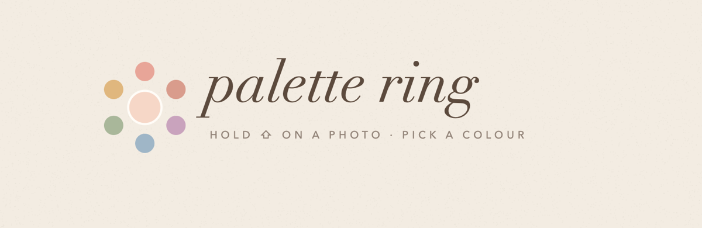
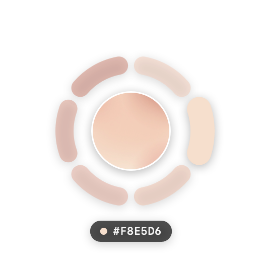
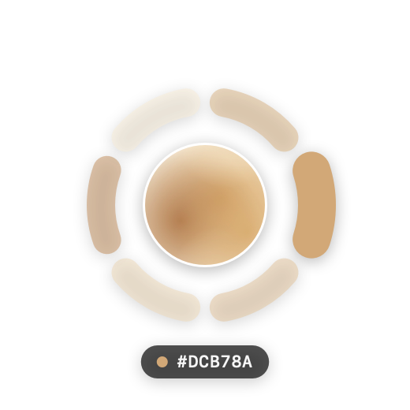
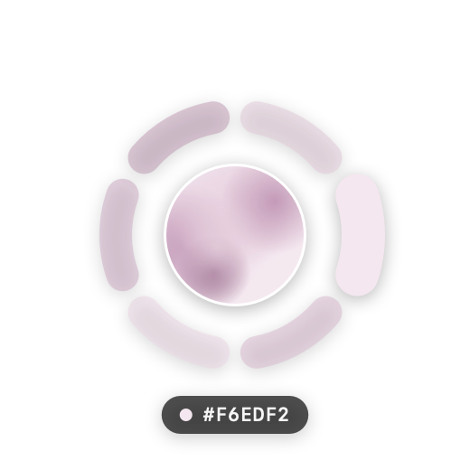
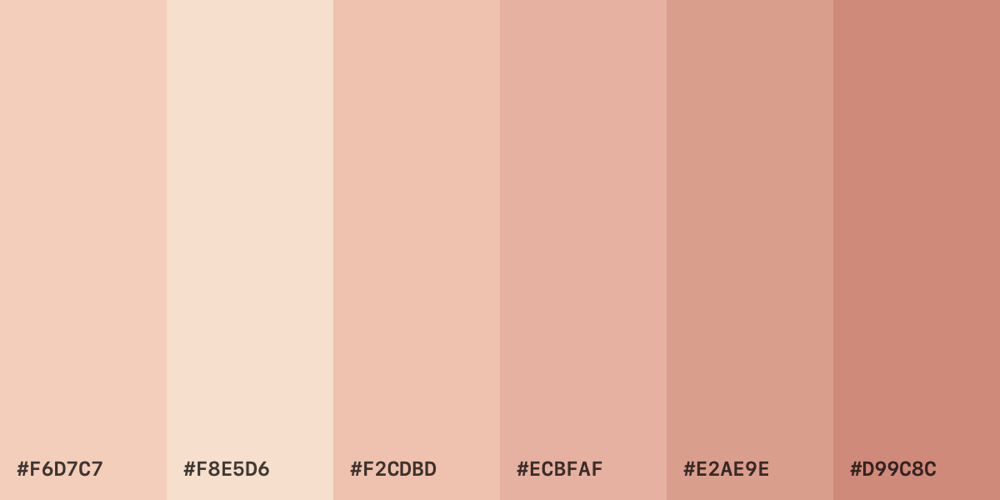

<p align="center">
  
</p>

<p align="center">
  <i>a tiny menu-bar app that pulls the colours out of your photos</i>
</p>

<br>

<p align="center">
  
  
  
</p>

<br>

## ◐ &nbsp;how it feels

select a photo in Finder, **hold** <kbd>⇧</kbd>, and its colours bloom in a ring around your cursor.
glide onto the one you like and let go.

- the colour you picked is **copied** as a hex code, ready to paste
- the whole palette is **saved** to Downloads as a png and a css file
- let go while you're still on the photo in the middle to **cancel**
- shift-clicking to select lots of photos in Finder won't open the ring, so it stays out of the way

<p align="center">
  
</p>

<p align="center">
  <sub>the palette it saves to Downloads</sub>
</p>

<br>

## ☕︎ &nbsp;install

```sh
git clone https://github.com/tejuaee/palette-ring.git
cd palette-ring
./build.sh
open "build/Palette Ring.app"
```

you'll need the Xcode command line tools for `swiftc` (`xcode-select --install`).
a little <code>◐</code> appears in your menu bar while it's running.

the first time, macOS asks to let Palette Ring control Finder. click **OK**, because that's how it sees which photo you've selected. no Accessibility permission needed ♡

<details>
<summary><b>how it works</b></summary>
<br>

- checks the Shift key about 60 times a second, but only while Finder is in front
- asks Finder for the current selection through AppleScript
- shrinks the photo to 96 px and runs k-means (k = 6) to find the main colours
- draws the ring in a see-through panel that clicks pass straight through
</details>

<details>
<summary><b>from the terminal</b></summary>
<br>

```sh
"build/Palette Ring.app/Contents/MacOS/PaletteRing" --preview photo.jpg out/
```

prints the hex codes and writes the palette files plus a ring preview image.
</details>

<br>

<p align="center">
  <sub>one swift file · no dependencies · made for fun ♡</sub>
  <br>
  <sub>pairs nicely with <a href="https://github.com/tejuaee/moodboard-maker">moodboard maker</a></sub>
</p>
